# GMY Soru Atlası 2021–2026

Gümrük Müşavir Yardımcılığı sınavının 2021, 2022, 2023, 2024, 2025 ve 2026 yıllarına ait A kitapçıklarındaki **600 sorunun** konu, soru kalıbı, soru tipi ve dayandığı mevzuata göre analizi. Etkileşimli sürüm: `GMY_Soru_Atlasi.html` (tarayıcıda açın).

## İçindekiler

1. [Sınavın yapısı](#1-sınavın-yapısı)
2. [Yıl yıl analiz](#2-yıl-yıl-analiz)
3. [Yılların karşılaştırması](#3-yılların-karşılaştırması)
4. [Sonuç: en çok neyden, nasıl soruluyor?](#4-sonuç-en-çok-neyden-nasıl-soruluyor)
5. [Yöntem ve dosyalar](#5-yöntem-ve-dosyalar)

## 1. Sınavın yapısı

| Bölüm | Soru no | 2021 | 2022 | 2023 | 2024 | 2025 | 2026 |
|---|---|---|---|---|---|---|---|
| Türkçe | 1–5 | 5 | 5 | 5 | 5 | 5 | 5 |
| Matematik | 6–10 | 5 | 5 | 5 | 5 | 5 | 5 |
| Tarih (İnkılap) | 11–15 | 5 | 5 | 5 | 5 | 5 | 5 |
| Anayasa / Vatandaşlık | 16–20 | 5 | 5 | 5 | 5 | 5 | 5 |
| Gümrük Mevzuatı | 21–100 | 80 | 80 | 80 | 80 | 80 | 80 |

Sınav her yıl 100 soru / 150 dakika; puanın **%80'i gümrük mevzuatından** geliyor.

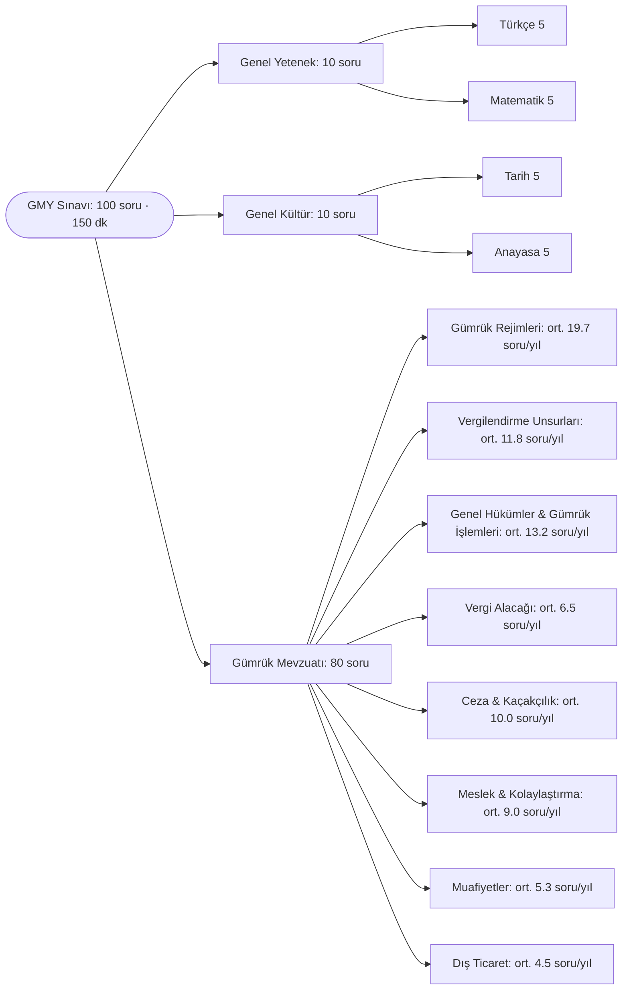

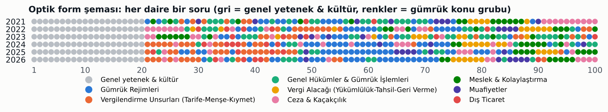

## 2. Yıl yıl analiz

### 2021

- Sınavı Ankara Üniversitesi (ASYM) hazırladı; 2022'den itibaren Hacettepe Üniversitesi hazırlıyor. 2021'in konu dağılımı bu yüzden diğer yıllardan belirgin biçimde farklı.
- En çok soru Kaçakçılık (5607) konusundan geldi: 10 soru, üstelik 91–100 arası bloğun tamamı. Altı yıl içinde tek bir konudan yılda gelen en yüksek ikinci sayı bu.
- Gümrük Müşavirliği & Temsil ve Muafiyetler 8'er soruyla ikinci sırada. Liman bayileri, kabotaj, posta kolisi listesi gibi özel işlemler (6 soru) ile tasfiye (5 soru) yalnızca bu yıl bu kadar ağırlık taşıdı.
- Gümrük Kanunu'nun idari para cezaları (md. 234–241) hiç sorulmadı. Ceza ağırlığı tamamen 5607'de.
- Soru tipinde tanım soruları zirvede (15). "Ne ad verilir" kalıbı çok sık (çeki listesi, proforma fatura, üçgen trafik, ulusal transit).
- Kalıp: %58 olumlu, %34 olumsuz kök, 7 öncüllü ve 1 eşleştirme (kontrol hatlarının renkleri). Matematikte işlem ve örüntü, tarihte Millî Mücadele ağırlıktaydı.

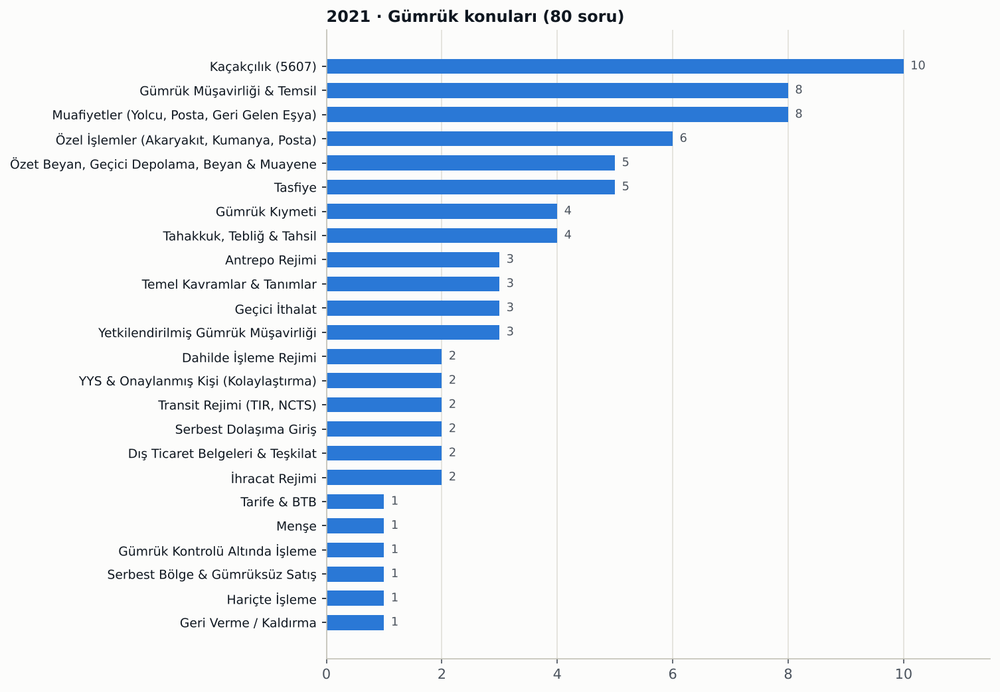

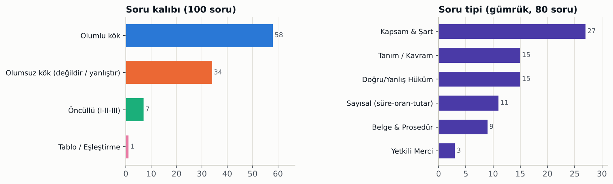

Konu tablosu ve soru numaraları

| Konu | Soru | Soru numaraları |
|---|---|---|
| Kaçakçılık (5607) | 10 | 91, 92, 93, 94, 95, 96, 97, 98, 99, 100 |
| Gümrük Müşavirliği & Temsil | 8 | 22, 37, 76, 77, 83, 84, 85, 86 |
| Muafiyetler (Yolcu, Posta, Geri Gelen Eşya) | 8 | 30, 40, 58, 64, 72, 73, 74, 90 |
| Özel İşlemler (Akaryakıt, Kumanya, Posta) | 6 | 32, 59, 65, 67, 69, 70 |
| Özet Beyan, Geçici Depolama, Beyan & Muayene | 5 | 24, 33, 36, 50, 51 |
| Tasfiye | 5 | 34, 56, 60, 62, 63 |
| Gümrük Kıymeti | 4 | 29, 31, 35, 39 |
| Tahakkuk, Tebliğ & Tahsil | 4 | 78, 79, 81, 88 |
| Antrepo Rejimi | 3 | 23, 41, 54 |
| Temel Kavramlar & Tanımlar | 3 | 26, 43, 66 |
| Geçici İthalat | 3 | 45, 53, 75 |
| Yetkilendirilmiş Gümrük Müşavirliği | 3 | 48, 57, 87 |
| Dahilde İşleme Rejimi | 2 | 21, 89 |
| YYS & Onaylanmış Kişi (Kolaylaştırma) | 2 | 25, 82 |
| Transit Rejimi (TIR, NCTS) | 2 | 28, 47 |
| Serbest Dolaşıma Giriş | 2 | 42, 55 |
| Dış Ticaret Belgeleri & Teşkilat | 2 | 49, 61 |
| İhracat Rejimi | 2 | 68, 71 |
| Tarife & BTB | 1 | 27 |
| Menşe | 1 | 38 |
| Gümrük Kontrolü Altında İşleme | 1 | 44 |
| Serbest Bölge & Gümrüksüz Satış | 1 | 46 |
| Hariçte İşleme | 1 | 52 |
| Geri Verme / Kaldırma | 1 | 80 |

### 2022

- Yılın konusu Gümrük Kıymeti: 11 soru (47–56 ve 98–99) ile altı yılın tek konudan gelen en yüksek sayısı. Aynı eşya, benzer eşya, ilişkili kişiler, royalti, hesaplanmış kıymet, komisyonlar ve kur çevrimi soruldu.
- Sınav Kaçakçılık bloğuyla açıldı (21–27, 7 soru). Ardından özet beyan, geçici depolama, beyan ve muayene (7) ile GK idari para cezaları ve itiraz (6) geliyor.
- Olumsuz kök oranı %42 ile altı yılın en yüksek değeri (2026'da %41). "Hangisi yanlıştır / değildir" kalıbı her 5 sorudan 2'sinde var.
- 2009/15481 Karar'dan 5 soru geldi (hediyelik eşya limiti 150/430 Avro, taşıt muafiyeti, kişisel/şahsi eşya). Ayrıca o yıla ait 241/1 usulsüzlük cezası tutarı (235 TL) soruldu; güncel tutarlar takip edilmeli.
- Matematik okul düzeyinde temel işlemdi (denklem, bileşik kesir, üslü sayılar, bölünebilme).

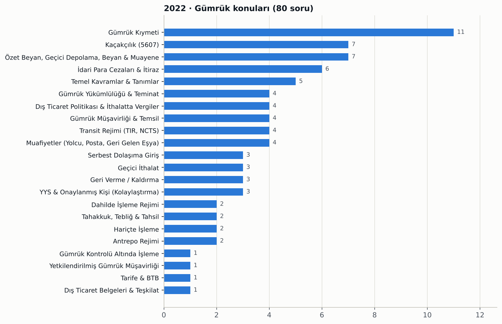

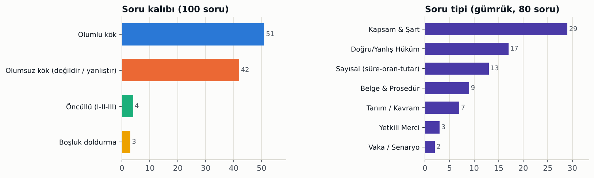

Konu tablosu ve soru numaraları

| Konu | Soru | Soru numaraları |
|---|---|---|
| Gümrük Kıymeti | 11 | 44, 47, 48, 49, 50, 51, 52, 53, 55, 98, 99 |
| Kaçakçılık (5607) | 7 | 21, 22, 23, 24, 25, 26, 27 |
| Özet Beyan, Geçici Depolama, Beyan & Muayene | 7 | 32, 45, 77, 78, 80, 82, 96 |
| İdari Para Cezaları & İtiraz | 6 | 36, 42, 65, 66, 69, 70 |
| Temel Kavramlar & Tanımlar | 5 | 28, 31, 33, 41, 62 |
| Gümrük Yükümlülüğü & Teminat | 4 | 29, 34, 87, 92 |
| Dış Ticaret Politikası & İthalatta Vergiler | 4 | 30, 35, 38, 43 |
| Gümrük Müşavirliği & Temsil | 4 | 63, 64, 79, 100 |
| Transit Rejimi (TIR, NCTS) | 4 | 73, 74, 75, 76 |
| Muafiyetler (Yolcu, Posta, Geri Gelen Eşya) | 4 | 83, 84, 85, 86 |
| Serbest Dolaşıma Giriş | 3 | 37, 39, 40 |
| Geçici İthalat | 3 | 57, 60, 61 |
| Geri Verme / Kaldırma | 3 | 89, 90, 91 |
| YYS & Onaylanmış Kişi (Kolaylaştırma) | 3 | 93, 94, 95 |
| Dahilde İşleme Rejimi | 2 | 46, 97 |
| Tahakkuk, Tebliğ & Tahsil | 2 | 54, 88 |
| Hariçte İşleme | 2 | 58, 59 |
| Antrepo Rejimi | 2 | 68, 72 |
| Gümrük Kontrolü Altında İşleme | 1 | 56 |
| Yetkilendirilmiş Gümrük Müşavirliği | 1 | 67 |
| Tarife & BTB | 1 | 71 |
| Dış Ticaret Belgeleri & Teşkilat | 1 | 81 |

### 2023

- Kanun'un genel hükümleri yılı: Temel Kavramlar (11) ve Özet Beyan / Beyan & Muayene (11) birlikte gümrük sorularının %27,5'ini oluşturuyor. Gümrük idaresi, gümrük statüsü, yükümlü, Türkiye Gümrük Bölgesi, Kanun'un amacı ve brüt ağırlık tanımları soruldu.
- Sorular "Gümrük Kanunu'na göre…" diye başlıyor: 46/80 soru doğrudan 4458'e dayanıyor (altı yılın en yükseği).
- Meslek mevzuatı 8 soru: disiplin cezaları (uyarma, kınama, 6 ay–1 yıl alıkoyma, meslekten çıkarma), sınava en fazla 3 kez giriş hakkı, 5 yıl belge saklama.
- Sayısal sorular zirvede (19): BTB 6 yıl, BMB 3 yıl, 45/20 gün, tebligat zamanaşımı 3 yıl, kısmi muafiyet %3.
- En kolay sınav: 49 soru kolay, yalnızca 8 soru zor. Transit, serbest dolaşım, kolaylaştırma (YYS/OKS) ve tasfiyeden hiç soru gelmedi. Matematiğin 5 sorusu da günlük hayat problemiydi.

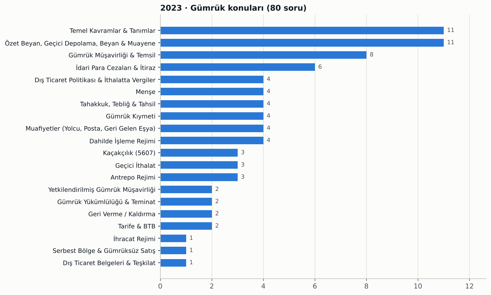

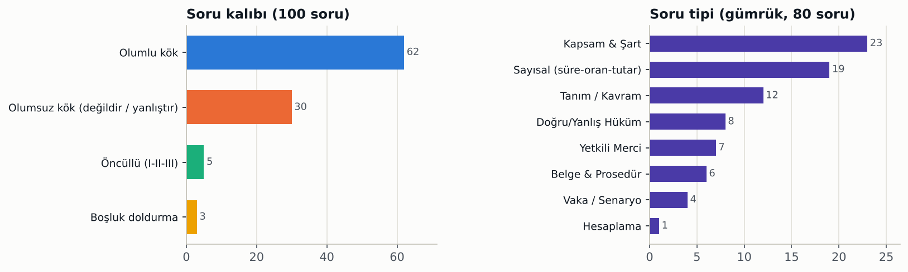

Konu tablosu ve soru numaraları

| Konu | Soru | Soru numaraları |
|---|---|---|
| Temel Kavramlar & Tanımlar | 11 | 31, 57, 63, 66, 67, 71, 75, 83, 91, 92, 97 |
| Özet Beyan, Geçici Depolama, Beyan & Muayene | 11 | 38, 39, 40, 74, 78, 80, 81, 84, 90, 93, 95 |
| Gümrük Müşavirliği & Temsil | 8 | 23, 24, 25, 26, 27, 28, 89, 94 |
| İdari Para Cezaları & İtiraz | 6 | 21, 29, 30, 33, 43, 60 |
| Dış Ticaret Politikası & İthalatta Vergiler | 4 | 36, 45, 49, 72 |
| Menşe | 4 | 41, 42, 64, 87 |
| Tahakkuk, Tebliğ & Tahsil | 4 | 44, 61, 70, 77 |
| Gümrük Kıymeti | 4 | 46, 47, 79, 98 |
| Muafiyetler (Yolcu, Posta, Geri Gelen Eşya) | 4 | 48, 50, 53, 59 |
| Dahilde İşleme Rejimi | 4 | 55, 56, 65, 99 |
| Kaçakçılık (5607) | 3 | 22, 51, 73 |
| Geçici İthalat | 3 | 34, 37, 54 |
| Antrepo Rejimi | 3 | 35, 62, 85 |
| Yetkilendirilmiş Gümrük Müşavirliği | 2 | 32, 82 |
| Gümrük Yükümlülüğü & Teminat | 2 | 68, 88 |
| Geri Verme / Kaldırma | 2 | 69, 76 |
| Tarife & BTB | 2 | 86, 96 |
| İhracat Rejimi | 1 | 52 |
| Serbest Bölge & Gümrüksüz Satış | 1 | 58 |
| Dış Ticaret Belgeleri & Teşkilat | 1 | 100 |

### 2024

- Ağırlık rejimlere ve vergilendirme unsurlarına kaydı. İdari para cezaları (8), Kıymet (7), Menşe (7), Dış Ticaret Politikası (6) ve Transit (6) öne çıkıyor.
- En zor sınav (17 zor soru) ve vaka sorularının zirvesi (9). Rejim içinde hangi cezanın uygulanacağı soruldu: geçici ithalatta bilgisiz çıkış, ihraçta %10 fark, 235/2-a, transitte aykırılık, kaçakçılıkta teşebbüs, Erenköy→Sarp transitinin sona ermesi.
- Menşe bloğu (29–41): tümüyle elde edilen eşya, yetersiz işçilik, menşe şahadetnamesinin içeriği, GTS'de Form A, Çin→Almanya→Türkiye trafiğinde menşe ve serbest dolaşım ayrımı.
- Dış ticaret politikasında İthalat Rejimi Kararı listeleri, ek mali yükümlülük, İGV, kota, GTS ve sınır ticareti soruldu. Gümrük Yönetmeliği'ne dayanan 20 soru ile altı yılın en yükseği.
- Olumsuz kök %37, 7 öncüllü soru var. Doğru şıklarda B 28 kez çıktı; D ise yalnızca 12 kez.

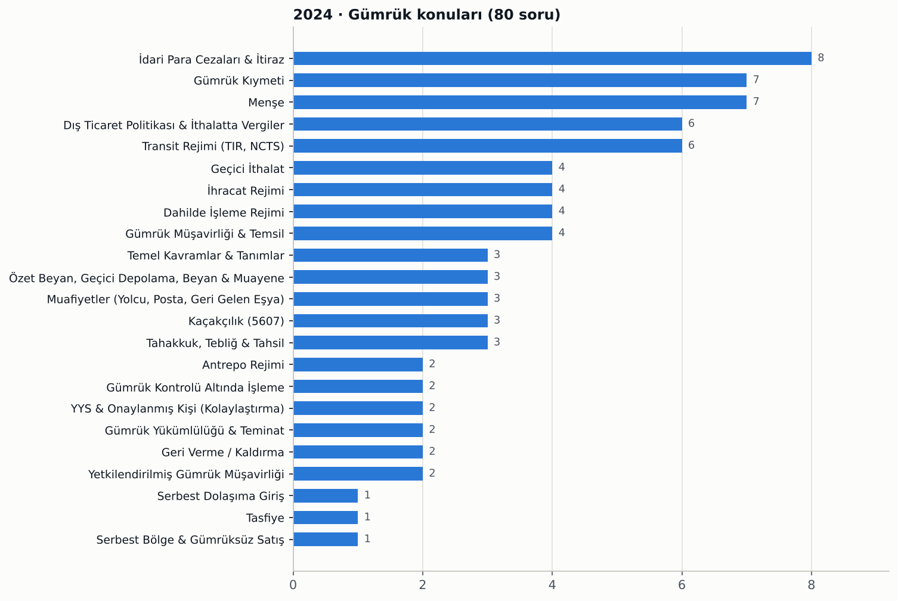

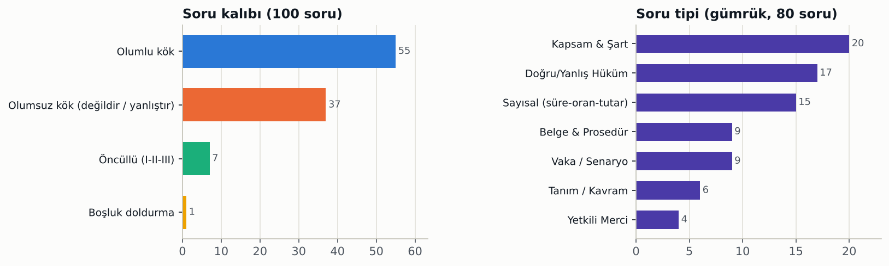

Konu tablosu ve soru numaraları

| Konu | Soru | Soru numaraları |
|---|---|---|
| İdari Para Cezaları & İtiraz | 8 | 26, 32, 48, 52, 57, 82, 85, 95 |
| Gümrük Kıymeti | 7 | 21, 22, 23, 24, 25, 27, 28 |
| Menşe | 7 | 29, 33, 34, 38, 40, 41, 68 |
| Dış Ticaret Politikası & İthalatta Vergiler | 6 | 31, 35, 36, 37, 42, 44 |
| Transit Rejimi (TIR, NCTS) | 6 | 56, 58, 59, 60, 61, 92 |
| Geçici İthalat | 4 | 39, 69, 70, 72 |
| İhracat Rejimi | 4 | 45, 49, 55, 97 |
| Dahilde İşleme Rejimi | 4 | 50, 51, 53, 54 |
| Gümrük Müşavirliği & Temsil | 4 | 87, 89, 90, 94 |
| Temel Kavramlar & Tanımlar | 3 | 30, 47, 93 |
| Özet Beyan, Geçici Depolama, Beyan & Muayene | 3 | 46, 86, 100 |
| Muafiyetler (Yolcu, Posta, Geri Gelen Eşya) | 3 | 62, 71, 98 |
| Kaçakçılık (5607) | 3 | 65, 66, 67 |
| Tahakkuk, Tebliğ & Tahsil | 3 | 79, 80, 81 |
| Antrepo Rejimi | 2 | 63, 64 |
| Gümrük Kontrolü Altında İşleme | 2 | 73, 74 |
| YYS & Onaylanmış Kişi (Kolaylaştırma) | 2 | 75, 76 |
| Gümrük Yükümlülüğü & Teminat | 2 | 77, 78 |
| Geri Verme / Kaldırma | 2 | 83, 84 |
| Yetkilendirilmiş Gümrük Müşavirliği | 2 | 88, 91 |
| Serbest Dolaşıma Giriş | 1 | 43 |
| Tasfiye | 1 | 96 |
| Serbest Bölge & Gümrüksüz Satış | 1 | 99 |

### 2025

- Gümrük rejimleri grubu 27/80 ile altı yılın en yükseği. Dahilde İşleme (7, 54–60 bloğu), Serbest Dolaşım & Nihai Kullanım (5) ve Geçici İthalat (5) öne çıkıyor.
- En çok soru Menşe konusundan geldi: 9 soru (33–44). A.TR ile EUR.1 ayrımı, yetersiz işçilik, tümüyle elde edilen eşya, menşe şahadetnamesinin 6 ay içinde sonradan ibrazı ve basım yetkilisi TOBB/TESK/TİM soruldu.
- Soru kalıbı değişti: 17 öncüllü (önceki yıllarda 4–7) ve 5 boşluk doldurma sorusu var. Olumsuz kök %24'e indi (altı yılın en düşüğü).
- Mevzuat kaynağı genişledi. 4458'e dayanan soru 21'e düştü; tebliğler (9: Nihai Kullanım, Tarife/BTB, Seri 149, Kara Taşıtları) ve dış ticaret mevzuatı (6) zirve yaptı.
- Hesap soruları geldi: kendiliğinden başvuruda ceza tutarı, kullanılmış taşıtta yıl düşümü, EXW'den kıymet. Kaçakçılık 3 soruya geriledi. Genel yetenekte matematik çok temel günlük hayat problemleriydi.

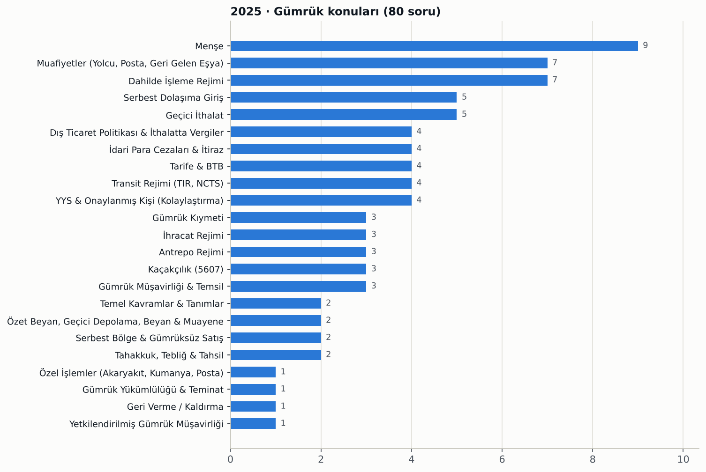

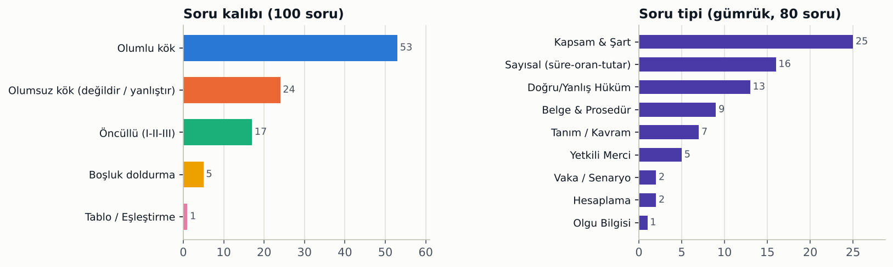

Konu tablosu ve soru numaraları

| Konu | Soru | Soru numaraları |
|---|---|---|
| Menşe | 9 | 33, 34, 35, 38, 39, 40, 41, 42, 44 |
| Muafiyetler (Yolcu, Posta, Geri Gelen Eşya) | 7 | 49, 65, 66, 67, 68, 71, 84 |
| Dahilde İşleme Rejimi | 7 | 54, 55, 56, 57, 58, 59, 60 |
| Serbest Dolaşıma Giriş | 5 | 27, 28, 30, 31, 36 |
| Geçici İthalat | 5 | 79, 80, 81, 83, 85 |
| Dış Ticaret Politikası & İthalatta Vergiler | 4 | 22, 37, 43, 45 |
| İdari Para Cezaları & İtiraz | 4 | 24, 32, 82, 96 |
| Tarife & BTB | 4 | 29, 46, 47, 94 |
| Transit Rejimi (TIR, NCTS) | 4 | 61, 62, 63, 64 |
| YYS & Onaylanmış Kişi (Kolaylaştırma) | 4 | 86, 87, 88, 89 |
| Gümrük Kıymeti | 3 | 21, 25, 26 |
| İhracat Rejimi | 3 | 52, 53, 95 |
| Antrepo Rejimi | 3 | 69, 74, 75 |
| Kaçakçılık (5607) | 3 | 76, 77, 78 |
| Gümrük Müşavirliği & Temsil | 3 | 98, 99, 100 |
| Temel Kavramlar & Tanımlar | 2 | 23, 50 |
| Özet Beyan, Geçici Depolama, Beyan & Muayene | 2 | 48, 73 |
| Serbest Bölge & Gümrüksüz Satış | 2 | 70, 72 |
| Tahakkuk, Tebliğ & Tahsil | 2 | 90, 91 |
| Özel İşlemler (Akaryakıt, Kumanya, Posta) | 1 | 51 |
| Gümrük Yükümlülüğü & Teminat | 1 | 92 |
| Geri Verme / Kaldırma | 1 | 93 |
| Yetkilendirilmiş Gümrük Müşavirliği | 1 | 97 |

### 2026

- Sınavı yine Hacettepe Üniversitesi hazırladı (A kitapçığı). Gümrük bölümü bloklarla ilerliyor: 21–30 ağırlıkla kıymet, 31–42 serbest dolaşım, temel kavramlar, menşe ve fikri haklar, 43–50 ihracat ve özel işlemler, 56–62 antrepo, 63–66 transit, 67–72 geçici ithalat, 83–88 muafiyetler, 92–96 meslek, 97–100 kaçakçılık.
- En çok soru Gümrük Kıymeti konusundan geldi: 8 soru (2022'den sonraki en yüksek sayı). İlişkili kişiler, kıymet yöntemlerinin sırası, istisnai kıymet ve kur çevrimi soruldu; hesap sorusu gelmedi.
- Antrepo (5) ve ihracat (5) altı yılın en yüksek seviyesinde; geçici ithalat 5, muafiyetler 6, meslek 5 soru. 2009/15481 Karar'a dayanan soru 7 ile altı yılın zirvesi. Menşe 2025'teki 9 sorudan 2'ye indi.
- Kalıpta olumsuz kök yeniden yükseldi: 41/100. Öncüllü soru 6'ya indi. Doğru/yanlış hüküm sorusu 20 ile altı yılın en yükseği; 4458'e dayanan soru yeniden 38'e çıktı.
- Önceki yıllardan neredeyse aynı tekrar eden sorular: disiplin cezalarında 3 yıl zamanaşımı (93 = 2023/24), müşavirlerin belge saklama süresi (92 = 2023/23), hediyelik eşya limiti 150/430 Avro (83 = 2022/86), kusurlu eşyada 1 yıl (77 = 2025/93), meslekten çıkarmada Yüksek Disiplin Kurulu (95 = 2024/90), CPD karnesi (70 = 2022/61).
- Genel yetenekte matematik yine temel işlem ve problemdi. 10. soruda D ve E şıkları aynı ("3 saat 40 dakika"); bu bir soru hatası, B cevabını etkilemiyor. Zorluk: 42 kolay, 12 zor soru.

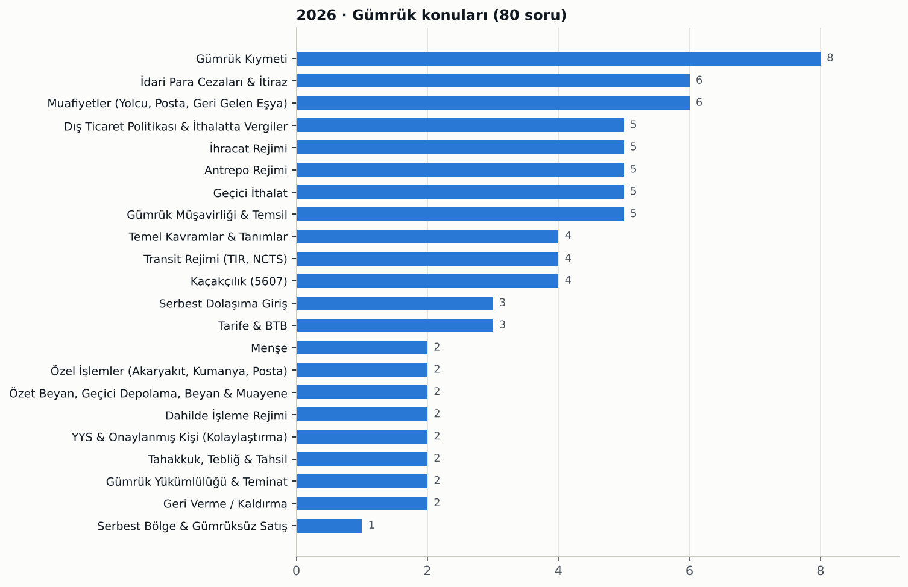

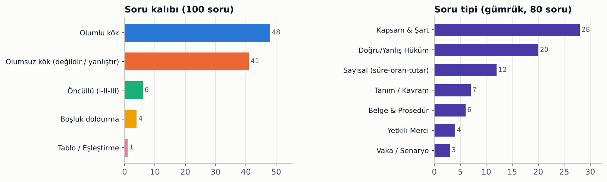

Konu tablosu ve soru numaraları

| Konu | Soru | Soru numaraları |
|---|---|---|
| Gümrük Kıymeti | 8 | 21, 22, 23, 25, 27, 28, 29, 30 |
| İdari Para Cezaları & İtiraz | 6 | 24, 26, 34, 53, 81, 82 |
| Muafiyetler (Yolcu, Posta, Geri Gelen Eşya) | 6 | 49, 83, 85, 86, 87, 88 |
| Dış Ticaret Politikası & İthalatta Vergiler | 5 | 33, 38, 40, 41, 90 |
| İhracat Rejimi | 5 | 43, 44, 48, 50, 69 |
| Antrepo Rejimi | 5 | 56, 57, 58, 59, 62 |
| Geçici İthalat | 5 | 67, 68, 70, 71, 72 |
| Gümrük Müşavirliği & Temsil | 5 | 92, 93, 94, 95, 96 |
| Temel Kavramlar & Tanımlar | 4 | 32, 36, 84, 89 |
| Transit Rejimi (TIR, NCTS) | 4 | 63, 64, 65, 66 |
| Kaçakçılık (5607) | 4 | 97, 98, 99, 100 |
| Serbest Dolaşıma Giriş | 3 | 31, 35, 39 |
| Tarife & BTB | 3 | 54, 55, 91 |
| Menşe | 2 | 37, 42 |
| Özel İşlemler (Akaryakıt, Kumanya, Posta) | 2 | 45, 47 |
| Özet Beyan, Geçici Depolama, Beyan & Muayene | 2 | 46, 61 |
| Dahilde İşleme Rejimi | 2 | 51, 52 |
| YYS & Onaylanmış Kişi (Kolaylaştırma) | 2 | 73, 74 |
| Tahakkuk, Tebliğ & Tahsil | 2 | 75, 80 |
| Gümrük Yükümlülüğü & Teminat | 2 | 76, 78 |
| Geri Verme / Kaldırma | 2 | 77, 79 |
| Serbest Bölge & Gümrüksüz Satış | 1 | 60 |

## 3. Yılların karşılaştırması

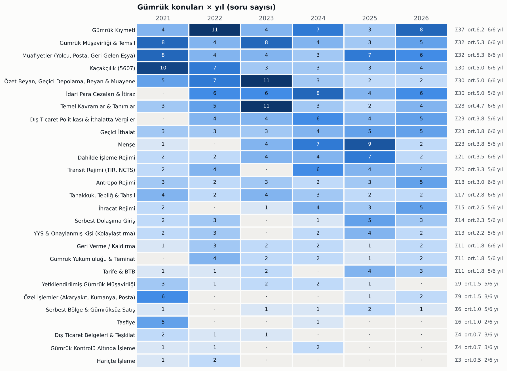

| # | Konu | 2021 | 2022 | 2023 | 2024 | 2025 | 2026 | Toplam | Ort./yıl | Çıktığı yıl | Eğilim (2024–26 vs 2021–23) |
|---|---|---|---|---|---|---|---|---|---|---|---|
| 1 | Gümrük Kıymeti | 4 | 11 | 4 | 7 | 3 | 8 | 37 | 6.2 | 6/6 | ■ -0.3 |
| 2 | Gümrük Müşavirliği & Temsil | 8 | 4 | 8 | 4 | 3 | 5 | 32 | 5.3 | 6/6 | ▼ -2.7 |
| 3 | Muafiyetler (Yolcu, Posta, Geri Gelen Eşya) | 8 | 4 | 4 | 3 | 7 | 6 | 32 | 5.3 | 6/6 | ■ +0.0 |
| 4 | Kaçakçılık (5607) | 10 | 7 | 3 | 3 | 3 | 4 | 30 | 5.0 | 6/6 | ▼ -3.3 |
| 5 | Özet Beyan, Geçici Depolama, Beyan & Muayene | 5 | 7 | 11 | 3 | 2 | 2 | 30 | 5.0 | 6/6 | ▼ -5.3 |
| 6 | İdari Para Cezaları & İtiraz | 0 | 6 | 6 | 8 | 4 | 6 | 30 | 5.0 | 5/6 | ▲ +2.0 |
| 7 | Temel Kavramlar & Tanımlar | 3 | 5 | 11 | 3 | 2 | 4 | 28 | 4.7 | 6/6 | ▼ -3.3 |
| 8 | Dış Ticaret Politikası & İthalatta Vergiler | 0 | 4 | 4 | 6 | 4 | 5 | 23 | 3.8 | 5/6 | ▲ +2.3 |
| 9 | Geçici İthalat | 3 | 3 | 3 | 4 | 5 | 5 | 23 | 3.8 | 6/6 | ▲ +1.7 |
| 10 | Menşe | 1 | 0 | 4 | 7 | 9 | 2 | 23 | 3.8 | 5/6 | ▲ +4.3 |
| 11 | Dahilde İşleme Rejimi | 2 | 2 | 4 | 4 | 7 | 2 | 21 | 3.5 | 6/6 | ▲ +1.7 |
| 12 | Transit Rejimi (TIR, NCTS) | 2 | 4 | 0 | 6 | 4 | 4 | 20 | 3.3 | 5/6 | ▲ +2.7 |
| 13 | Antrepo Rejimi | 3 | 2 | 3 | 2 | 3 | 5 | 18 | 3.0 | 6/6 | ■ +0.7 |
| 14 | Tahakkuk, Tebliğ & Tahsil | 4 | 2 | 4 | 3 | 2 | 2 | 17 | 2.8 | 6/6 | ▼ -1.0 |
| 15 | İhracat Rejimi | 2 | 0 | 1 | 4 | 3 | 5 | 15 | 2.5 | 5/6 | ▲ +3.0 |
| 16 | Serbest Dolaşıma Giriş | 2 | 3 | 0 | 1 | 5 | 3 | 14 | 2.3 | 5/6 | ▲ +1.3 |
| 17 | YYS & Onaylanmış Kişi (Kolaylaştırma) | 2 | 3 | 0 | 2 | 4 | 2 | 13 | 2.2 | 5/6 | ■ +1.0 |
| 18 | Geri Verme / Kaldırma | 1 | 3 | 2 | 2 | 1 | 2 | 11 | 1.8 | 6/6 | ■ -0.3 |
| 19 | Gümrük Yükümlülüğü & Teminat | 0 | 4 | 2 | 2 | 1 | 2 | 11 | 1.8 | 5/6 | ■ -0.3 |
| 20 | Tarife & BTB | 1 | 1 | 2 | 0 | 4 | 3 | 11 | 1.8 | 5/6 | ▲ +1.0 |
| 21 | Yetkilendirilmiş Gümrük Müşavirliği | 3 | 1 | 2 | 2 | 1 | 0 | 9 | 1.5 | 5/6 | ▼ -1.0 |
| 22 | Özel İşlemler (Akaryakıt, Kumanya, Posta) | 6 | 0 | 0 | 0 | 1 | 2 | 9 | 1.5 | 3/6 | ▼ -1.0 |
| 23 | Serbest Bölge & Gümrüksüz Satış | 1 | 0 | 1 | 1 | 2 | 1 | 6 | 1.0 | 5/6 | ■ +0.7 |
| 24 | Tasfiye | 5 | 0 | 0 | 1 | 0 | 0 | 6 | 1.0 | 2/6 | ▼ -1.3 |
| 25 | Dış Ticaret Belgeleri & Teşkilat | 2 | 1 | 1 | 0 | 0 | 0 | 4 | 0.7 | 3/6 | ▼ -1.3 |
| 26 | Gümrük Kontrolü Altında İşleme | 1 | 1 | 0 | 2 | 0 | 0 | 4 | 0.7 | 3/6 | ■ +0.0 |
| 27 | Hariçte İşleme | 1 | 2 | 0 | 0 | 0 | 0 | 3 | 0.5 | 2/6 | ▼ -1.0 |

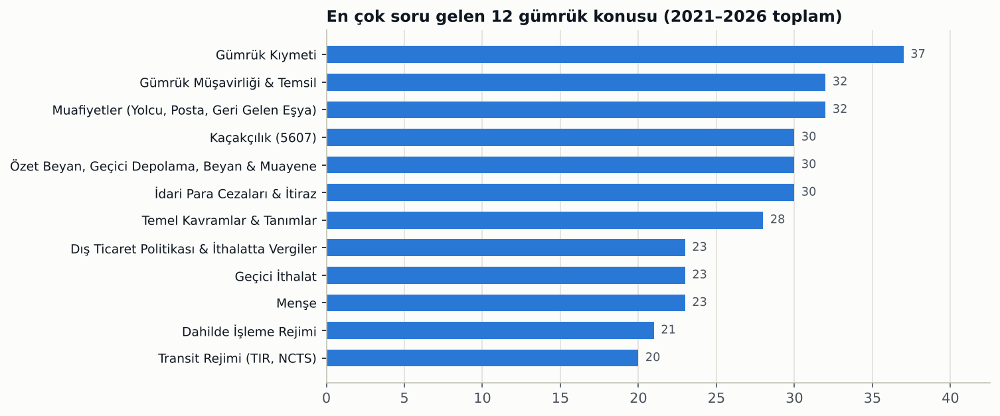

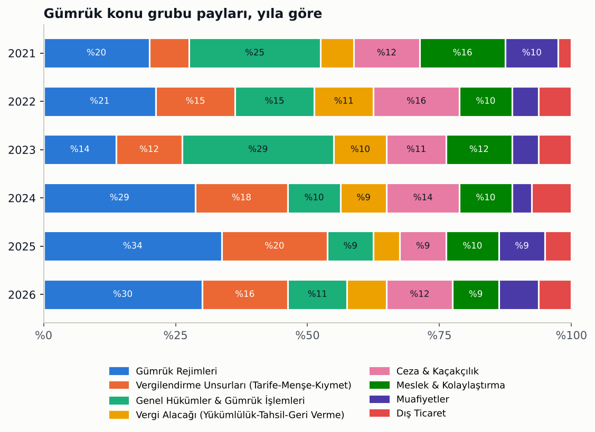

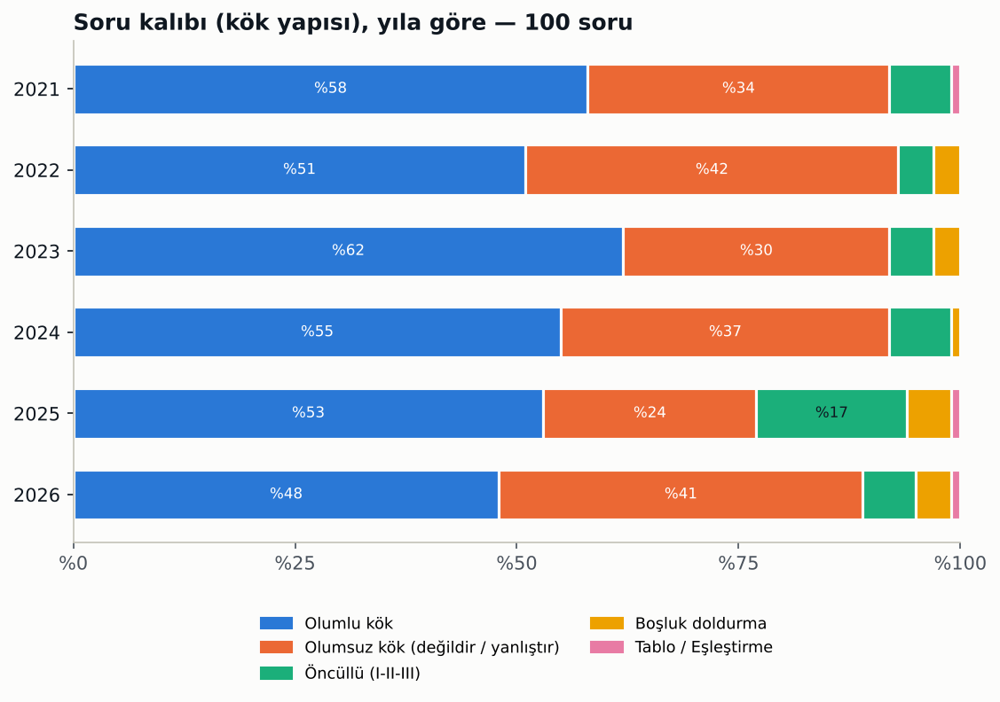

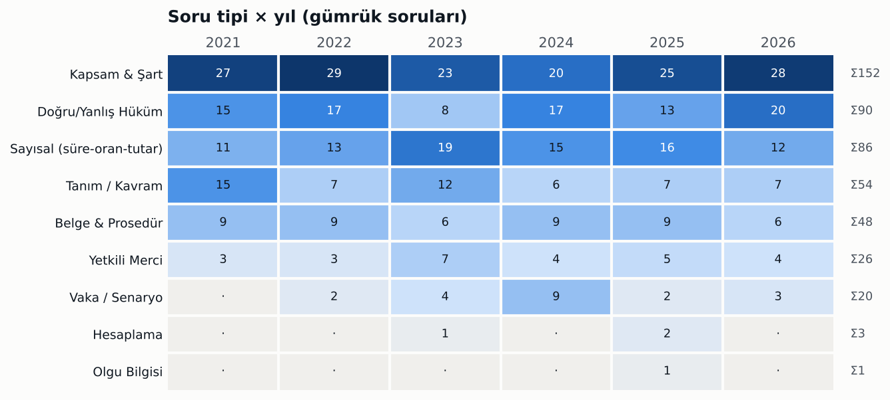

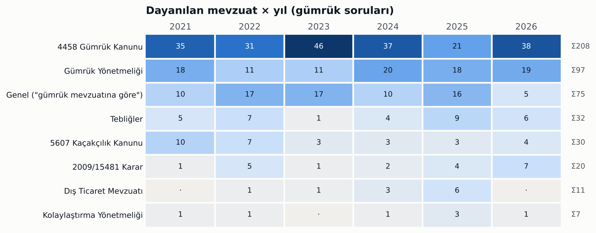

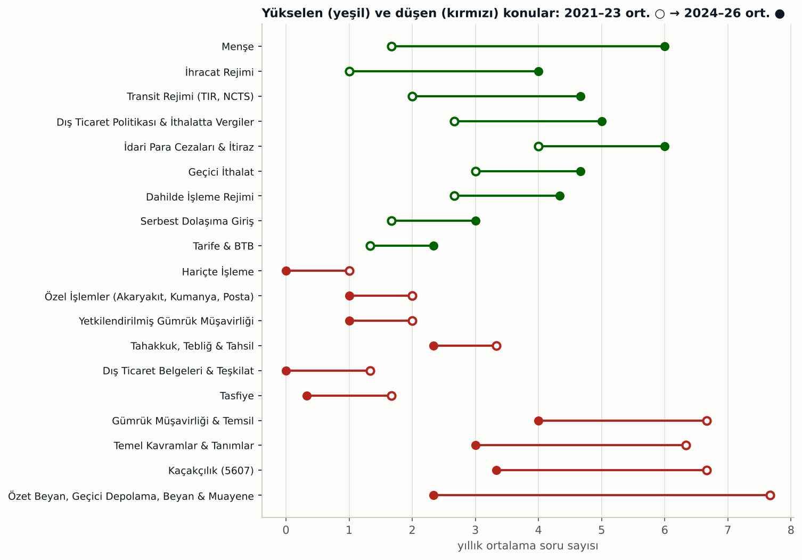

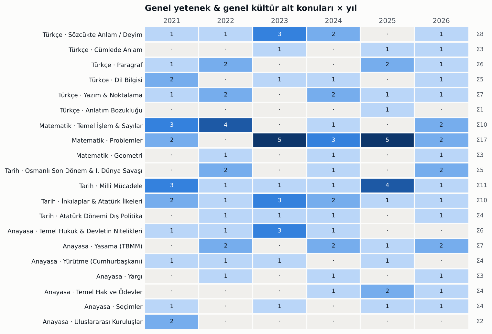

### Zorluk ve doğru şık dağılımı

|  | 2021 | 2022 | 2023 | 2024 | 2025 | 2026 |
|---|---|---|---|---|---|---|
| Kolay | 39 | 36 | 49 | 31 | 42 | 42 |
| Orta | 52 | 53 | 43 | 52 | 48 | 46 |
| Zor | 9 | 11 | 8 | 17 | 10 | 12 |
| Doğru şık A | 20 | 14 | 11 | 17 | 11 | 20 |
| Doğru şık B | 18 | 19 | 20 | 28 | 21 | 18 |
| Doğru şık C | 21 | 19 | 26 | 21 | 24 | 23 |
| Doğru şık D | 19 | 23 | 23 | 12 | 22 | 21 |
| Doğru şık E | 22 | 25 | 20 | 22 | 22 | 18 |

### Tekrar eden soru kalıpları

| Soru kalıbı | Konu | 2021 | 2022 | 2023 | 2024 | 2025 | 2026 | Doğru bilgi |
|---|---|---|---|---|---|---|---|---|
| Antrepo tipleri (A–F; genel/özel) | Antrepo Rejimi | 54 | 68, 72 | 85 | 63 | · | 57, 62 | Genel antrepo: A, B ve F tipi; özel antrepo: C, D ve E tipi. A tipinde işletici stok kaydını tutar ve noksanlıktan sorumludur; E tipinde stok kaydı eşya izin hak sahibinin depolama yerine ulaşınca yapılır. |
| Özet beyan sonrası GOİK verilme süresi | Özet Beyan, Geçici Depolama, Beyan & Muayene | 36 | 32 | 39, 74 | · | · | · | Denizyolu ile gelen eşyada 45 gün, diğer yollarda 20 gün. |
| Geri gelen eşyada süre ve süre aşımı | Muafiyetler (Yolcu, Posta, Geri Gelen Eşya) | 30, 64 | · | 53 | 71 | 49 | 49 | İhraçtan itibaren 3 yıl içinde geri gelirse muafiyet; süre fiilî ihraç (ör. uçağın hareketi) tarihinden başlar. |
| Yolcu eşyası ambarı / depolama süresi | Muafiyetler (Yolcu, Posta, Geri Gelen Eşya) | 40 | · | 50 | · | 71, 84 | · | Yolcu eşyası ambarlarında ve geçici depolama yerlerinde 3 ay. |
| Geçici ithalat rejiminin tanımı | Geçici İthalat | 45, 75 | · | 54 | · | 79 | 71, 72 | Serbest dolaşımda olmayan eşyanın tam/kısmi muafiyetle kullanılıp olağan yıpranma dışında değişmeden yeniden ihracı. |
| Kısmi muafiyette aylık vergi oranı | Geçici İthalat | 53 | · | 37 | 72 | · | · | Rejimde kalınan her ay için, serbest dolaşıma girseydi alınacak vergilerin %3'ü. |
| Sonradan tespit edilen vergide tebligat zamanaşımı | Tahakkuk, Tebliğ & Tahsil | · | · | 70 | 79 | 90 | · | Gümrük yükümlülüğünün doğduğu tarihten itibaren 3 yıl. |
| Ek tahakkukta ödeme süresi | Tahakkuk, Tebliğ & Tahsil | · | 88 | · | 81 | 91 | · | Tebliğden itibaren 15 gün; yazılı istem ve teminatla 30 güne kadar uzatılabilir. |
| İtiraz süresi ve karar süresi (GK 242) | İdari Para Cezaları & İtiraz | · | 66 | 77 | 95 | · | 80 | Tebliğden itibaren 15 gün içinde bir üst makama; itiraz 30 gün içinde karara bağlanır. |
| Kaçakçılıkla mücadelede görevli olmayan | Kaçakçılık (5607) | 93 | 25 | 22 | · | · | · | Mülki amirler, Emniyet, Jandarma, Sahil Güvenlik ve gümrük muhafaza görevlidir; askerî birlikler ve özel güvenlik görevli değildir. |
| Alıcı ile satıcı arasında ilişki sayılan haller | Gümrük Kıymeti | · | 99 | 98 | 28 | · | 21, 28 | Tek acentelik veya aynı sanayi kolunda faaliyet göstermek tek başına ilişki sayılmaz. |
| Kıymette yabancı paranın çevrilmesi | Gümrük Kıymeti | 35 | 55 | · | 25 | · | 30 | Yükümlülüğün başladığı tarihte geçerli TCMB döviz satış kuru. |
| Alıcının kendi hesabına pazarlama faaliyeti | Gümrük Kıymeti | 31 | 52 | · | 23 | · | · | Satıcıya dolaylı ödeme sayılmaz, kıymete eklenmez (GK 27/1-b yardımı da değildir). |
| Aynı / benzer eşya unsurları | Gümrük Kıymeti | · | 48, 98 | · | 27 | · | · | Benzer eşyada kalite, itibar ve ticari marka dikkate alınır; fiyat bir unsur değildir. |
| Gümrük rejimi olan/olmayan, ekonomik etkili rejimler | Temel Kavramlar & Tanımlar | 26, 43 | 28, 33 | 63 | · | · | 89 | Kanun'da 8 rejim var. Geçici ihracat ve nihai kullanım rejim değildir; transit ekonomik etkili rejim değildir. |
| Şartlı muafiyet düzenlemesinin kapsamı | Temel Kavramlar & Tanımlar | · | 62 | 83 | 30 | · | · | Transit, antrepo, şartlı muafiyet sistemli DİR, GKAİ ve geçici ithalat; geri ödeme sistemi ve ihracat değildir. |
| GOİK (gümrükçe onaylanmış işlem veya kullanım) kapsamı | Temel Kavramlar & Tanımlar | · | 31 | 31 | 93 | · | 32 | Rejime tabi tutma, serbest bölgeye girme, yeniden ihraç, imha ve gümrüğe terk. Teslim ve geçici depolama GOİK değildir. |
| Telafi edici vergi (DİR'de tercihli tarife) | Dahilde İşleme Rejimi | 89 | 46 | · | 54 | · | · | Tercihli tarife, bünyedeki serbest dolaşımda olmayan eşyanın vergilerinin ödenmesine bağlıysa TEV doğar ve ihracat beyannamesinin tescil tarihine göre hesaplanır. |
| Serbest dolaşım statüsünün kaybı | Serbest Dolaşıma Giriş | 42 | 39 | · | · | 31 | 39 | Beyannamenin iptali ve geri ödeme sistemli DİR'de vergilerin geri verilmesi statüyü kaybettirir; nihai kullanım kaybettirmez. |
| Tümüyle elde edilen eşya / yetersiz işçilik | Menşe | · | · | 64 | 33, 34 | 33, 38, 41 | 37 | İthal girdiyle üretilen ürün tümüyle elde edilmiş sayılmaz. Tarife pozisyonu değişikliği ve iplikten kumaş üretimi yetersiz işçilik değildir. |
| Rejim kodunun açıklaması | İhracat Rejimi | · | · | 52 | 49 | 53 | · | 1000: daha önce rejime tabi tutulmamış eşyanın kesin ihracatı. 1040: muafiyete tabi olmadan serbest dolaşım ile eş zamanlı yurt içi kullanıma giren eşyanın kesin ihracatı. 1023: geri gelmek üzere geçici ihraç edilen eşyanın kesin ihracatı. |
| İthalat Rejimi Kararı eki listeler | Dış Ticaret Politikası & İthalatta Vergiler | · | 35 | · | 31 | 37 | · | I tarım ürünleri, II sanayi ürünleri, III işlenmiş tarım ürünleri, IV balıkçılık ve su ürünleri, V gümrük vergisi askıya alınan sanayi ürünleri, VI sivil hava taşıtlarında kullanılacak ürünler. |
| Gümrük müşavir yardımcısı olma şartları | Gümrük Müşavirliği & Temsil | 83 | 63 | · | · | 98 | 94 | T.C. vatandaşlığı, medeni hakları kullanma ehliyeti, kamu haklarından mahrum olmamak, memuriyetten çıkarılmamış olmak, sayılan suçlardan hüküm giymemiş olmak. |
| Yetkilendirilmiş yükümlü ve onaylanmış kişi şartları ve süreleri | YYS & Onaylanmış Kişi (Kolaylaştırma) | 25 | 93 | · | 75, 76 | 87, 88 | 73, 74 | YYS için en az 3 yıl faaliyet, OKS için 2 yıl; YYS süresizdir ve 5 yılda bir izlenir. |
| Teminat olarak kabul edilmeyen değer | Gümrük Yükümlülüğü & Teminat | · | 92 | · | · | 92 | 76 | Kabul edilenler: nakit TL, süresiz banka teminat mektubu, DİBS ve TCMB'nin kabul ettiği dövizler. Soru iki yılda da 92. sırada. |
| Bilgi değişikliğini bildirme süresi | Gümrük Müşavirliği & Temsil | 84 | · | 26 | · | · | · | İzin belgesi numarası, şirket adı, temsilci gibi bilgilerdeki değişiklik bir hafta içinde bildirilir. |
| İlişkinin beyan edilmemesi cezası | İdari Para Cezaları & İtiraz | · | · | 43 | 26 | · | · | Vergi kaybı olmasa da 241/1'deki tutarın iki katı usulsüzlük cezası. |
| Çeki listesinin tanımı | Dış Ticaret Belgeleri & Teşkilat | 49 | 81 | · | · | · | · | Kaplardaki eşya miktarını gösteren belge çeki listesidir. Soru metni iki yılda birebir aynı. |
| Kıymet yöntemlerinin uygulama sırası | Gümrük Kıymeti | 29 | · | · | · | · | 22 | Yöntemler sırayla uygulanır; beyan sahibinin yazılı talebi uygun bulunursa indirgeme yönteminden önce hesaplanmış kıymet yöntemi uygulanabilir. |
| Menşe şahadetnamesinin içeriği | Menşe | · | · | · | · | 35 | 42 | Menşe şahadetnamesinde gönderen ve alıcı, kapların marka, numara ve sayısı ile eşyanın cinsi ve menşe ülkesi yer alır. |
| Fikri haklarda re'sen durdurma ve ihtiyati tedbir | Dış Ticaret Politikası & İthalatta Vergiler | · | 30 | · | · | · | 38, 40, 41 | Açık delil varsa gümrük idaresi eşyayı hak sahibinin başvurusu için re'sen durdurur; hak sahibi süresinde ihtiyati tedbir getirmezse işlemlere devam edilir. |
| İhracatta beyanname yerine geçen belgeler | İhracat Rejimi | · | · | · | 45 | · | 44 | ATA ve CPD karnesi, Form 302 ve kumanya listesi beyanname yerine kullanılabilir. |
| Beyanname kapatma süresinin uzatılması | İhracat Rejimi | · | · | · | · | 95 | 50 | Geçici depolama yerine konulmadan ihraç edilecek eşyada kapatma süresi makul sebeplerle gümrük idaresince uzatılabilir. |
| CPD karnesi | Geçici İthalat | · | 61 | · | · | · | 70 | Ticari ve kişisel kara taşıtları için kefil kuruluşlarca verilen uluslararası gümrük belgesidir. |
| Kusurlu eşyada geri verme başvuru süresi | Geri Verme / Kaldırma | · | · | · | · | 93 | 77 | Başvuru 3 yıl değil, vergilerin yükümlüye tebliğinden itibaren 1 yıl içinde yapılır. |
| Hediyelik eşya muafiyet limiti | Muafiyetler (Yolcu, Posta, Geri Gelen Eşya) | · | 86 | · | · | · | 83 | 15 yaş altı yolcular için 150 Avro, 15 yaş üstü yolcular için 430 Avro. |
| Yasak ve kısıtlama gerekçeleri | Dış Ticaret Politikası & İthalatta Vergiler | · | · | 72 | · | · | 90 | Kamu ahlakı, düzeni ve güvenliği; insan, hayvan ve bitki sağlığı; ulusal hazineler ve fikri-sınai haklar gerekçesiyle yasak ve kısıtlama konulabilir. |
| Müşavirlerin belge saklama süresi | Gümrük Müşavirliği & Temsil | · | · | 23 | · | · | 92 | Gümrük müşavirleri defter, vekaletname ve düzenledikleri belgeleri 5 yıl saklar. |
| Disiplin cezalarında zamanaşımı | Gümrük Müşavirliği & Temsil | · | · | 24 | · | · | 93 | Adli kovuşturma hali dışında disiplin cezaları aykırılığın tespitinden itibaren 3 yıl içinde uygulanmazsa zamanaşımına uğrar. Soru iki yılda neredeyse aynı metinle soruldu. |
| Meslekten çıkarmada yetkili merci | Gümrük Müşavirliği & Temsil | · | · | · | 90 | · | 95 | Meslekten çıkarma cezasını Ticaret Bakanlığı Yüksek Disiplin Kurulu verir. |
| Kaçakçılıkta eşya türüne göre ceza artırımı | Kaçakçılık (5607) | 96 | · | · | · | · | 99 | Akaryakıt, tütün, makaron, etil alkol ve yaprak sigara kâğıdı gibi eşyada ceza artırılır. |

## 4. Sonuç: en çok neyden, nasıl soruluyor?

### En çok soru gelen konular

- Puanın %80'i gümrük mevzuatından geliyor (her yıl 80/100). Genel yetenek ve genel kültür sabit 20 soru.
- Konu grubu olarak zirvede Gümrük Rejimleri: 480 sorunun 118'i (%25). Ardından Genel Hükümler & Gümrük İşlemleri (79), Vergilendirme Unsurları (Tarife-Menşe-Kıymet) (71), Ceza & Kaçakçılık (60), Meslek & Kolaylaştırma (54) geliyor.
- Tek konu olarak ilk sekiz: Gümrük Kıymeti (37), Gümrük Müşavirliği & Temsil (32), Muafiyetler (Yolcu, Posta, Geri Gelen Eşya) (32), Özet Beyan, Geçici Depolama, Beyan & Muayene (30), Kaçakçılık (5607) (30), İdari Para Cezaları & İtiraz (30), Temel Kavramlar & Tanımlar (28), Menşe (23). Bu sekiz konu gümrük sorularının %50'si oluşturuyor.
- 11 konu altı sınavın hepsinde çıktı: Gümrük Kıymeti, Gümrük Müşavirliği & Temsil, Muafiyetler (Yolcu, Posta, Geri Gelen Eşya), Özet Beyan, Geçici Depolama, Beyan & Muayene, Kaçakçılık (5607), Temel Kavramlar & Tanımlar, Geçici İthalat, Dahilde İşleme Rejimi, Antrepo Rejimi, Tahakkuk, Tebliğ & Tahsil, Geri Verme / Kaldırma.
- Genel yetenek ve genel kültürde en çok Problemler (17), Millî Mücadele (11), Temel İşlem & Sayılar (10), İnkılaplar & Atatürk İlkeleri (10), Sözcükte Anlam / Deyim (8) soruldu.

### Eğilim: sınav nereye kayıyor?

- Yükselenler (2021–23 ortalaması → 2024–26 ortalaması): Menşe 1,7 → 6, İhracat Rejimi 1 → 4, Transit Rejimi (TIR, NCTS) 2 → 4,7, Dış Ticaret Politikası & İthalatta Vergiler 2,7 → 5.
- Düşenler: Özet Beyan, Geçici Depolama, Beyan & Muayene 7,7 → 2,3, Kaçakçılık (5607) 6,7 → 3,3, Temel Kavramlar & Tanımlar 6,3 → 3, Gümrük Müşavirliği & Temsil 6,7 → 4. Özel işlemler ve tasfiye artık seyrek soruluyor.
- Mevzuat kaynağı değişken: 4458'e dayanan gümrük sorusu 2023'te 46 iken 2025'te 21'e indi, 2026'da yeniden 38 oldu. Gümrük Yönetmeliği, tebliğler ve 2009/15481 Karar her yıl düzenli soru alıyor.
- Soru kalıbı yıldan yıla oynuyor: 2025'te 17 öncüllü ve 5 boşluk doldurma sorusu geldi; 2026'da öncüllü 6'ya indi, olumsuz kök %41'e çıktı.

### Hangi soru tipi, hangi kalıpla soruluyor?

- 600 sorunun %54'ü olumlu, %35'i olumsuz köklü ("değildir / yanlıştır / yer almaz"), %8'i öncüllü. Gümrük bölümünde olumsuz kök oranı %38.
- Gümrük sorularında en sık tipler: Kapsam & Şart (%32), Doğru/Yanlış Hüküm (%19), Sayısal (%18), Tanım (%11), Belge & Prosedür (%10), Yetkili Merci (%5), Vaka (%4).
- Kapsam & şart sorularının çoğu olumsuz köklü (152 sorunun 106'sı). Tipik GMY sorusu şu kalıpta: "… göre aşağıdakilerden hangisi X'in şartları / kapsamı arasında yer almaz?"
- Sayısal sorular çoğunlukla olumlu köklü (86 sorunun 76'sı) ve süre soruyor: kaç gün, kaç yıl, yüzde kaç. 90 doğru/yanlış hüküm sorusunun 62'si "hangisi yanlıştır" biçiminde.
- Doğru şıklar dengeli dağılmış (A 93, B 124, C 134, D 120, E 129). Şık tahminine dayanan bir strateji işe yaramaz.

### Çalışma stratejisi

- Önce 4458 sayılı Kanun + Gümrük Yönetmeliği çalışılmalı: gümrük sorularının %64'ü doğrudan bu ikisine dayanıyor.
- Bir süreler ve oranlar tablosu hazırlanmalı: 45/20 gün, 3 yıl tebligat, 15 gün ödeme ve itiraz, 30 gün itiraz kararı, %3 kısmi muafiyet, 3 ay yolcu eşyası, BTB 6 yıl, BMB 3 yıl, 5 yıl belge saklama, 3 yıl disiplin zamanaşımı, kusurlu eşyada 1 yıl, menşe şahadetnamesi için 6 ay.
- Sayılan listeler ezberlenmeli, çünkü olumsuz köklü kapsam soruları bunlardan geliyor: rejimler, GOİK, şartlı muafiyet düzenlemesi, ilişkili kişiler, kabul edilmeyen teminatlar, kaçakçılıkla görevliler, disiplin cezaları, antrepo tipleri, geçici ithalata konu olmayan eşya.
- Son yılların yönüne göre gümrük kıymeti, muafiyetler, geçici ithalat, antrepo, ihracat, fikri haklar ve İthalat Rejimi Kararı konularına ağırlık verilmeli. Öncüllü ve boşluk doldurma sorularıyla pratik yapılmalı.
- Tekrar eden soru kalıpları tablosundaki bilgiler mutlaka bilinmeli. 2026'da disiplin zamanaşımı, belge saklama süresi, hediyelik eşya limiti ve kusurlu eşyada geri verme süresi önceki yıllardaki metinlerle neredeyse aynı soruldu.

### Çalışma öncelik listesi (gümrük konuları)

**Öncelik 1 — yılda ort. 4+ soru:** Gümrük Kıymeti (6.2), Gümrük Müşavirliği & Temsil (5.3), Muafiyetler (Yolcu, Posta, Geri Gelen Eşya) (5.3), Kaçakçılık (5607) (5.0), Özet Beyan, Geçici Depolama, Beyan & Muayene (5.0), İdari Para Cezaları & İtiraz (5.0), Temel Kavramlar & Tanımlar (4.7)

**Öncelik 2 — yılda ort. 2–4 soru:** Dış Ticaret Politikası & İthalatta Vergiler (3.8), Geçici İthalat (3.8), Menşe (3.8), Dahilde İşleme Rejimi (3.5), Transit Rejimi (TIR, NCTS) (3.3), Antrepo Rejimi (3.0), Tahakkuk, Tebliğ & Tahsil (2.8), İhracat Rejimi (2.5), Serbest Dolaşıma Giriş (2.3), YYS & Onaylanmış Kişi (Kolaylaştırma) (2.2)

**Öncelik 3 — yılda ort. 2'den az:** Geri Verme / Kaldırma (1.8), Gümrük Yükümlülüğü & Teminat (1.8), Tarife & BTB (1.8), Yetkilendirilmiş Gümrük Müşavirliği (1.5), Özel İşlemler (Akaryakıt, Kumanya, Posta) (1.5), Serbest Bölge & Gümrüksüz Satış (1.0), Tasfiye (1.0), Dış Ticaret Belgeleri & Teşkilat (0.7), Gümrük Kontrolü Altında İşleme (0.7), Hariçte İşleme (0.5)

## 5. Yöntem ve dosyalar

Kaynak, depodaki altı A kitapçığı PDF'i: 2021 (Ankara Üniversitesi ASYM), 2022–2026 (Hacettepe Üniversitesi). Doğru cevaplar PDF'lerde kırmızıyla işaretlenmiş seçeneklerden otomatik okundu ve 600 sorunun hepsi için bulundu. 2026'nın tablo biçimli 51. sorusu sayfa görüntüsünden doğrulandı. 2022'nin görsel olan 7. ve 8. soruları sayfa görüntüsünden doğrulandı. Her soru sabit bir taksonomiye göre sınıflandırıldı: bölüm, 47 konu (27'si gümrük), 8 gümrük konu grubu, 5 soru kalıbı, 11 soru tipi, 8 mevzuat kaynağı ve zorluk. Soru kalıbı ayrıca metin kalıbı taramasıyla çapraz kontrol edildi. Konu, tip ve zorluk atamaları yoruma dayanır; sınırda kalan sorular, kökünde geçen kavrama göre atandı. "Öğrenilecek bilgi" alanı resmî cevap anahtarına dayanır. Bu bilgiler, özellikle her yıl güncellenen ceza tutarları ve süreler, mevzuatın güncel metninden ayrıca kontrol edilmelidir.

| Dosya | İçerik |
|---|---|
| `GMY_Soru_Atlasi.html` | Etkileşimli rapor: optik form şeması, yıl sekmeleri, ısı haritaları, tekrar eden soru kalıpları |
| `GMY_Soru_Atlasi.pdf` | Raporun yazdırılabilir A4 sürümü: yılların analizi art arda, ardından karşılaştırma ve sonuç |
| `gmy_soru_siniflandirma.csv` | 600 sorunun tamamı: konu, alt konu, kalıp, tip, mevzuat, zorluk, özet, öğrenilecek bilgi (Excel'de açılır) |
| `gmy_soru_siniflandirma.json` | Aynı veri, JSON |
| `grafikler/` | Bu rapordaki PNG grafikler |
| `kaynak/` | PDF'ten soru/cevap çıkarma ve rapor üretme betikleri, taksonomi |
